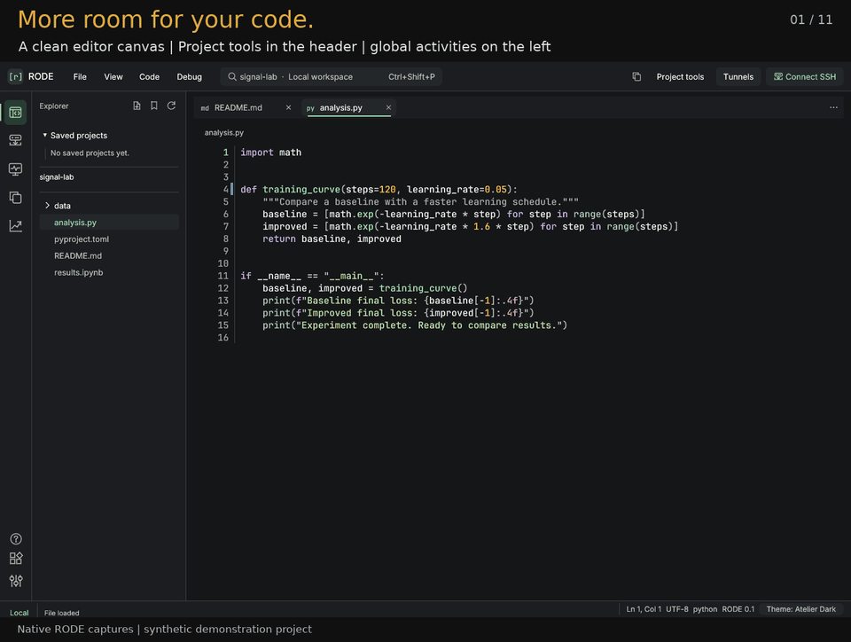

# RODE

A lightweight native Rust code editor for local and SSH projects, with persistent work sessions and configurable project-wide sandboxing. Tools start on demand, background work is bounded, and there is no automatic project-wide indexing.

- **[Work that survives editor exit](docs/terminals.md).** Enable persistence separately for terminals, coding agents, notebook kernels and debuggers, locally or over SSH. Reattach after editor exit or SSH loss with running work, kernel variables and debugger pause state retained. Terminals also support multiple attached windows without tmux/screen.
- **[Remote projects through your SSH setup](docs/remote.md).** The default Rust SSH client needs no local `ssh` executable and supports aliases, keys, jump hosts and optional Linux Kerberos authentication through the system GSSAPI library. OpenSSH remains an explicit compatibility option. Reuse a compatible preinstalled remote helper, or deploy a matching native binary automatically. Shared native Rust services handle local and remote files and tools without a general Python prerequisite. File access and project shells reuse the authenticated connection; Git, tools and debuggers run where the files live.
- **[Compute-node return tunnels](docs/remote.md#compute-node-return-tunnels).** Start a native SSH reverse tunnel on this computer, even without a project, or on a connected SSH host. Its session service keeps the relay connection alive and reconnects after network loss; use the connection details or a saved return profile to reach the host's existing sshd through that relay.
- **[Project sandbox with explicit user controls](docs/sandbox.md).** Choose bubblewrap or rootless Landlock locally or over SSH. Editor I/O, agents and code tools use the project policy. User-operated Git defaults outside it; Git and interactive terminals have separate, visible sandbox controls. The backends have different isolation limits; unavailable enforcement is clearly labelled normal mode.
- **[Coding agents on the project host](docs/agents.md).** Use Codex, Claude Code / Anthropic, local models through Ollama, or ACP agents. Read Markdown replies with native LaTeX maths, browse saved conversations and control model, reasoning and tool permissions. Approvals cannot widen the active project sandbox.
- **[Slurm CPU/GPU allocations](docs/slurm.md).** Request resources for interactive shells, notebook kernels and debuggers. Run on compute nodes through the existing SSH connection, with persistent reservations for longer work.
- **Scientific and technical workspace.** Run [Jupyter notebooks](docs/notebooks.md), preview [Markdown](docs/markdown.md), build [LaTeX](docs/latex.md), and prepare [Marp slides](docs/marp.md). Read [PDFs](docs/pdf.md), [PowerPoint](docs/powerpoint.md) and [Word](docs/word.md) documents, view [images](docs/images.md), and inspect [binaries with hex editing and analysis](docs/binary.md) in the editor.
- **[Encrypted local and remote projects](docs/encrypted-projects.md).** Open gocryptfs storage as a normal project; locking requires active project jobs to stop.

Also included:

- [Standard, Emacs and Vim editing / pane shortcuts](docs/editing.md#keyboard-pane-navigation), plus [independent interface and syntax themes](docs/themes.md), including Atelier's light/dark pair, Sumi-e and Samurai artwork, and SynthWave ’84.
- [Multi-language highlighting and tools](docs/languages.md), [Git branches/worktrees, project environments and tasks](docs/project-tools.md), [Python/native debugging](docs/debugger.md), and [extensions](docs/extensions.md).
- On-demand [CPU/GPU host monitoring](docs/project-tools.md#host-monitor).

[](assets/rode-tour.mp4)

71-second tour · [MP4 video](assets/rode-tour.mp4) · [Still image](assets/rode-tour.png). Shows the welcome screen, activity-bar navigation, **Project tools**, saved projects in **Connections**, native Markdown/notebook equations, encrypted-folder browsing, **Undo last edits** and guarded **Close project**, plus **Atelier Light**, **Atelier Dark**, **Sumi-e Light**, **Samurai**, and **SynthWave ’84**. Native captures use synthetic profiles, a real notebook kernel and loopback SSH in normal mode; sandbox controls are shown without enforcement. Encrypted-project scenes show storage selection and setup without creating or unlocking a vault. A labelled offline agent fixture makes a real file edit and undoes it without model inference. The Slurm scene requests no allocation.

```sh
cargo xtask install
rode /path/to/project
# Or open a file directly:
rode /path/to/project/main.py
# Or connect to a remote computer:
rode --ssh user@host --remote-path '~/project'
```

Open **Project tools** below **Projects** in the left activity bar for Chat, Terminal, Git, Problems, Tasks, Shared folders and Settings. Close it to restore the full editor canvas; **Detach** and **Detach tab** move tools to separate windows while retaining their sessions. Connections, file transfers and monitoring live in the left activity bar.

Use **Project: Settings and sandbox access** in the command palette for categorised [project settings](docs/configuration.md#project-settings): code tools, environments, sandbox access, LaTeX and presentations. Each category saves its own changes.

Use **File → New editor window** for another native editor window with its own tabs.
Right-click a file tab to move it to a new or existing editor window. Closing an
editor window returns its tabs and unsaved edits to the main window. These windows
share one application process and project; chat, terminals and project tools keep
their existing location.

Bookmark the current local or SSH project with the small **bookmark icon** at the
right of **Saved projects** in the **Connections** sidebar. Click a saved project
to reopen it; right-click an entry to rename or remove it.
This bundled **Project bookmarks** extension can be disabled in **View → Extensions**.

For a coordinated light/dark interface, choose **Atelier Light** or **Atelier Dark**
from **View → Color theme**. Both include matching code and terminal palettes;
see [themes](docs/themes.md).

Manage saved SSH connections in the **Connections** sidebar. Right-click a profile
row to rename, edit or remove it; drag rows to save your preferred order.

Launching `rode` without a path opens the current working directory in **Normal** mode and shows Welcome with Explorer hidden. Saved sandbox settings are retained; use `--sandbox` to request isolation explicitly. A file argument normally uses its containing folder as the workspace. If global sandbox defaults reject that inferred folder, RODE opens just the file in **File mode**. Explicit `--sandbox` requests and saved folder policies still apply. See [startup behavior](docs/getting-started.md#run).

Linux is the validated platform. Source installation requires Rust 1.93+ and the
[build prerequisites](docs/getting-started.md). The installer builds the editor
and a static host/session helper, which RODE discovers automatically for SSH,
including on remote hosts with older glibc.

Remote projects require a Linux SSH server and a POSIX shell on the host. The
desktop uses embedded `russh` by default. Ordinary editing, terminals and sandbox
enforcement need no Python or tmux/screen. See [remote prerequisites](docs/remote.md#host-service-backends)
and [helper setup](docs/terminals.md#remote-helper-and-packaging).

Python/Jupyter features have their own dependencies; Python checks use `uvx ruff`
by default. PDF rendering and text extraction are bundled through pure-Rust
Hayro. Native [Word](docs/word.md) and [PowerPoint](docs/powerpoint.md) previews
also work without Office, LibreOffice or npm.

Debian/Ubuntu packages are built for release version tags or manually through **Actions → Package Debian → Run workflow**. Build locally with `scripts/build-deb.sh`; see [packaging and installation](docs/packaging.md).

[Documentation](https://pbenner.github.io/rode/) · [Setup](docs/getting-started.md) · [Agent setup](docs/agents.md) · [Development and hooks](docs/development.md) · [Source architecture](docs/architecture.md)

Development validation: `python3 scripts/validate.py` builds and runs lint, Rust
and CI integration/UI suites on private headless displays. Use `--preflight` to
check prerequisites; dependencies are never installed automatically. See the
[development guide](docs/development.md) for coverage reports and repeat/stress runs.

MIT licensed; bundled dependencies retain their [own licenses](docs/licensing.md). In-memory text/hex editing without a fixed file-size ceiling, and [image previews](docs/images.md) with bounded decoded pixels; no LSP.
