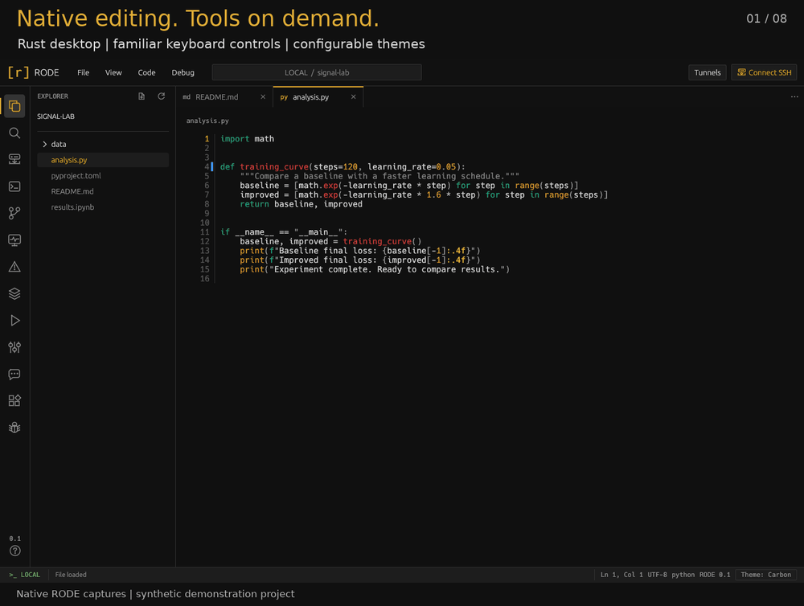

# RODE

A lightweight native Rust code editor for local and SSH projects, with persistent work sessions and configurable project-wide sandboxing. Tools start on demand, background work is bounded, and there is no automatic project-wide indexing.

- **[Work that survives editor exit](docs/terminals.md).** Enable persistence separately for terminals, coding agents, notebook kernels and debuggers, locally or over SSH. Reattach after editor exit or SSH loss with running work, kernel variables and debugger pause state retained. Terminals also support multiple attached windows without tmux/screen.
- **[Remote projects through your SSH setup](docs/remote.md).** The default Rust SSH client needs no local `ssh` executable and supports aliases, keys, jump hosts and optional Linux Kerberos authentication through the system GSSAPI library. OpenSSH remains an explicit compatibility option. Reuse a compatible preinstalled remote helper, or deploy a matching native binary automatically. Shared native Rust services handle local and remote files and tools without a general Python prerequisite. File access and project shells reuse the authenticated connection; Git, tools and debuggers run where the files live.
- **[Compute-node return tunnels](docs/remote.md#compute-node-return-tunnels).** Start a native SSH reverse tunnel on this computer, even without a project, or on a connected SSH host. Its session service keeps the relay connection alive and reconnects after network loss; use the connection details or a saved return profile to reach the host's existing sshd through that relay.
- **[Project sandbox with explicit user controls](docs/sandbox.md).** Choose bubblewrap or rootless Landlock locally or over SSH. Editor I/O, agents and code tools use the project policy. User-operated Git defaults outside it; Git and interactive terminals have separate, visible sandbox controls. The backends have different isolation limits; unavailable enforcement is clearly labelled normal mode.
- **[Coding agents on the project host](docs/agents.md).** Use Codex, Claude Code / Anthropic, local models through Ollama, or ACP agents. Read Markdown replies with native LaTeX maths, browse saved conversations and control model, reasoning and tool permissions. Approvals cannot widen the active project sandbox.
- **[Slurm CPU/GPU allocations](docs/slurm.md).** Request resources for interactive shells, notebook kernels and debuggers. Run on compute nodes through the existing SSH connection, with persistent reservations for longer work.
- **Scientific and technical workspace.** Run [Jupyter notebooks](docs/notebooks.md), preview [Markdown](docs/markdown.md), build [LaTeX](docs/latex.md), and prepare [Marp slides](docs/marp.md). Inspect [images](docs/images.md), [PDFs](docs/pdf.md) and [binaries with hex editing and analysis](docs/binary.md) in the editor.
- **[Encrypted local and remote projects](docs/encrypted-projects.md).** Open gocryptfs storage as a normal project; locking requires active project jobs to stop.

Also included:

- [Standard, Emacs and Vim editing / pane shortcuts](docs/editing.md#keyboard-pane-navigation), plus [independent interface and syntax themes](docs/themes.md), including Carbon Edge’s charcoal and amber cut-corner frames, Afterglow’s magenta and cyan accents, and Knight Rider’s black-and-red cockpit palette.
- [Multi-language highlighting and tools](docs/languages.md), [Git branches/worktrees, project environments and tasks](docs/project-tools.md), [Python/native debugging](docs/debugger.md), and [extensions](docs/extensions.md).
- On-demand [CPU/GPU host monitoring](docs/project-tools.md#host-monitor).

[](assets/rode-tour.mp4)

30-second tour · [MP4 video](assets/rode-tour.mp4) · [Still image](assets/rode-tour.png). Native UI captures with demo data; agent and Slurm scenes show setup controls.

```sh
cargo xtask install
rode /path/to/project
# Or open a file directly:
rode /path/to/project/main.py
# Or connect to a remote computer:
rode --ssh user@host --remote-path '~/project'
```

Use **Project: Settings and sandbox access** in the command palette for categorised [project settings](docs/configuration.md#project-settings): code tools, sandbox access, monitoring, LaTeX and presentations. Each category saves its own changes.

Manage saved SSH connections directly in the Explorer: right-click to rename,
edit or remove a connection, and drag rows to save your preferred order.

Files normally use their containing folder as the workspace. With sandbox defaults enabled, a file directly in your home directory opens in **File mode · Normal mode** instead: no project or project tools are started, and your sandbox preferences stay unchanged. Explicit `--sandbox` requests and saved folder policies still apply. See [file startup](docs/getting-started.md#run).

Linux is the validated platform. Build with Rust 1.89+ and the native build prerequisites; the source installer builds the editor and installs a static host/session helper beside it. RODE discovers that helper automatically, including on remote hosts with older glibc. Remote access requires an SSH server and a POSIX shell on the remote host; the desktop uses embedded `russh` by default. RODE uses a verified native Rust helper for SSH host operations; Python is not required for ordinary editing, terminals or sandbox enforcement. Python/Jupyter features retain their own dependencies. See [remote prerequisites](docs/remote.md#host-service-backends) and [static helper setup](docs/terminals.md#remote-helper-and-packaging); no tmux/screen is required. Python checks use `uvx ruff` by default. PDF previews require desktop Poppler tools (`poppler-utils`).

Debian/Ubuntu packages are built for release version tags or manually through **Actions → Package Debian → Run workflow**. Build locally with `scripts/build-deb.sh`; see [packaging and installation](docs/packaging.md).

[Documentation](https://pbenner.github.io/rode/) · [Setup](docs/getting-started.md) · [Agent setup](docs/agents.md) · [Development and hooks](docs/development.md) · [Source architecture](docs/architecture.md)

Development validation: `python3 scripts/validate.py` builds and runs lint, Rust
and CI integration/UI suites on private headless displays. Use `--preflight` to
check prerequisites; dependencies are never installed automatically. See the
[development guide](docs/development.md) for coverage reports and repeat/stress runs.

MIT licensed; bundled dependencies retain their [own licenses](docs/licensing.md). In-memory text/hex editing without a fixed file-size ceiling, and [image previews](docs/images.md) with bounded decoded pixels; no LSP.
