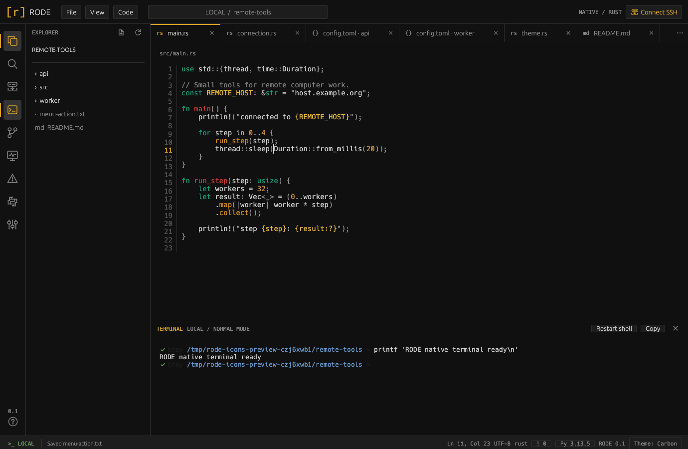

# RODE

A lightweight native Rust code editor for local and SSH projects, with persistent work sessions and configurable project-wide sandboxing. Tools start on demand, background work is bounded, and there is no automatic project-wide indexing.

- **[Work that survives editor exit](docs/terminals.md).** Enable persistence separately for terminals, coding agents, notebook kernels and debuggers, locally or over SSH. Reattach after editor exit or SSH loss with running work, kernel variables and debugger pause state retained. Terminals also support multiple attached windows without tmux/screen.
- **[Remote projects through your SSH setup](docs/remote.md).** Use existing OpenSSH aliases, keys and jump hosts. File access and project shells reuse the authenticated connection; Git, tools and debuggers run where the files live.
- **[One sandbox policy for the project](docs/sandbox.md).** Configure filesystem grants locally or over SSH; editor I/O, shells, agents and tools share the active policy. Unavailable sandboxing is clearly labelled normal mode.
- **[Coding agents on the project host](docs/agents.md).** Use Codex, local models through Ollama, or ACP agents. Browse saved conversations and control model, reasoning and tool permissions. Approvals cannot widen the active project sandbox.
- **[Slurm CPU/GPU allocations](docs/slurm.md).** Request resources for interactive shells, notebook kernels and debuggers. Run on compute nodes through the existing SSH connection, with persistent reservations for longer work.
- **Scientific and technical workspace.** Run [Jupyter notebooks](docs/notebooks.md), preview [Markdown](docs/markdown.md), build [LaTeX](docs/latex.md), and prepare [Marp slides](docs/marp.md). Inspect [images](docs/images.md), [PDFs](docs/pdf.md) and [binaries with hex editing and analysis](docs/binary.md) in the editor.
- **[Encrypted local and remote projects](docs/encrypted-projects.md).** Open gocryptfs storage as a normal project; locking requires active project jobs to stop.

Also included:

- [Standard, Emacs and Vim editing / pane shortcuts](docs/editing.md#keyboard-pane-navigation), plus [independent interface and syntax themes](docs/themes.md).
- [Multi-language highlighting and tools](docs/languages.md), [Git branches/worktrees, project environments and tasks](docs/project-tools.md), [Python/native debugging](docs/debugger.md), and [extensions](docs/extensions.md).
- On-demand [CPU/GPU host monitoring](docs/project-tools.md#host-monitor).



```sh
cargo install --locked --path .
rode /path/to/project
# Or connect to a remote computer:
rode --ssh user@host --remote-path '~/project'
```

Linux is the validated platform. Build with Rust 1.88+; Cargo installs both the editor and its headless terminal helper. Remote access requires OpenSSH, a POSIX shell, and Python 3. For hosts needing a static helper, see [terminal setup](docs/terminals.md#remote-helper-and-packaging); no tmux/screen is required. Python checks use `uvx ruff` by default. PDF previews require desktop Poppler tools (`poppler-utils`).

Debian/Ubuntu packages are built for release version tags or manually through **Actions → Package Debian → Run workflow**. Build locally with `scripts/build-deb.sh`; see [packaging and installation](docs/packaging.md).

[Documentation](https://pbenner.github.io/rode/) · [Setup](docs/getting-started.md) · [Agent setup](docs/agents.md) · [Development and hooks](docs/development.md) · [Source architecture](docs/architecture.md)

MIT licensed; bundled dependencies retain their [own licenses](docs/licensing.md). Text/hex editing up to 8 MiB and [image previews](docs/images.md) up to 32 MiB; no LSP.
