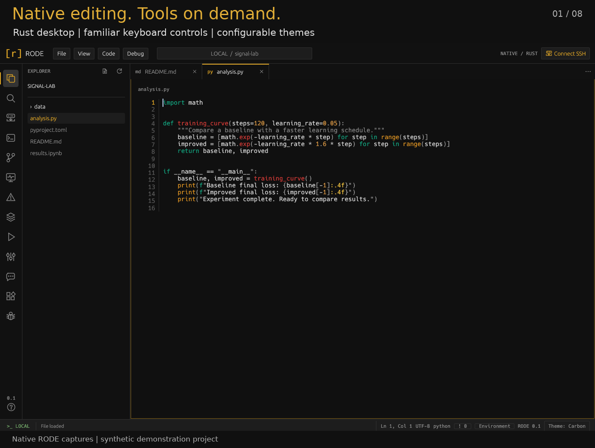

# RODE

A native Rust code editor for local files and remote computers over SSH.

RODE combines a familiar editor layout with a real terminal, configurable dark themes, and project tools that run on the computer hosting your files.

- Edit locally or through OpenSSH aliases, direct hosts, and jump hosts.
- Open project folders, navigate tabs, [preview Markdown](markdown.md), search within files, and use [persistent terminals](terminals.md), with multiple shells and shared reattachment.
- Edit and run [Jupyter notebooks](notebooks.md) with native cells and project-host kernels.
- Preview and export [Marp presentations](marp.md) from Markdown without an embedded browser.
- View [images](images.md) in read-only tabs, with zoom, fit, and transparency.
- [Debug Python and native code](debugger.md) locally or over SSH, with breakpoints, stepping and variable inspection.
- Work with Git branches/worktrees, Python environments, and Ruff formatting and diagnostics.
- Inspect CPU, memory, processes, and available GPU telemetry on demand.
- Optionally isolate project access with configurable bubblewrap policies.
- Use [agent chat](agents.md) with Codex, local models through Ollama, and compatible ACP agents inside the project sandbox.

[Get started](getting-started.md) · [Connect over SSH](remote.md) · [Keyboard shortcuts](editing.md)

Linux is the validated desktop platform. Remote file access requires a POSIX shell and Python 3. The current version edits UTF-8 files up to 8 MiB and previews raster images up to 32 MiB with bounded decoded pixels; general language servers and crash recovery are outside the current feature set.

For interactive GPU work, use [Slurm beside Persist](slurm.md) to request resources, follow pending/active status and open an allocated shell; persist/reattach it or explicitly release the job.

Use [Extensions](extensions.md) to manage bundled features and install project-host tool adapters. [Hex and binary analysis](binary.md) provides byte editing, object metadata and native x86 disassembly.
