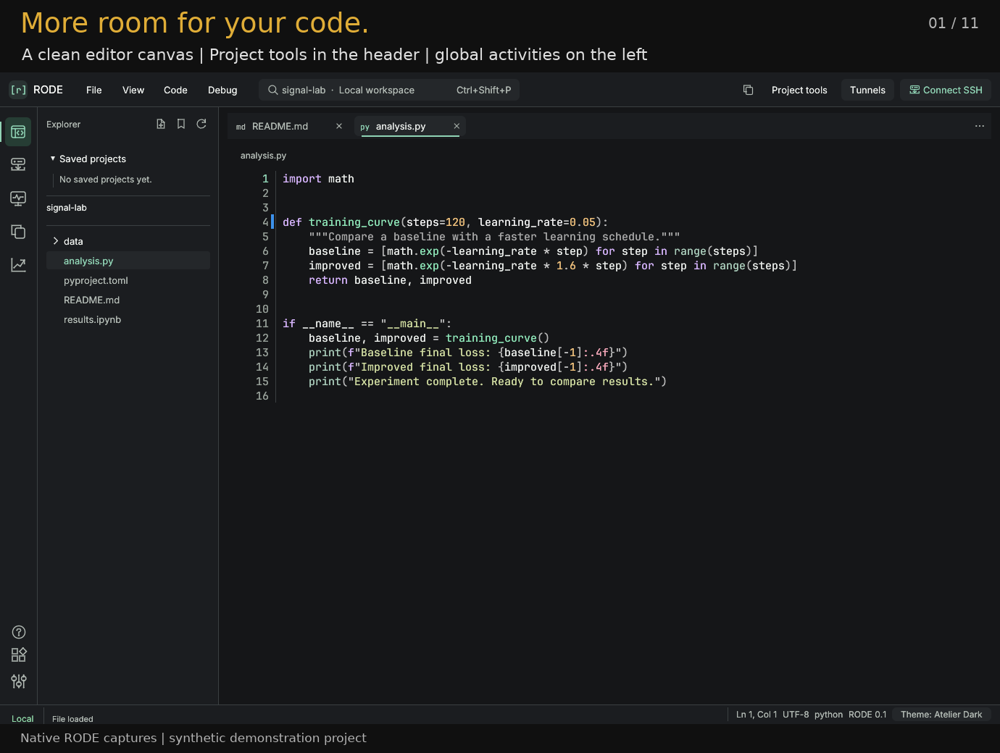

# RODE

A native Rust code editor for local files and remote computers over SSH.

RODE combines a native editor with persistent terminals, configurable light and dark themes, and project tools that run on the computer hosting your files.

The **Projects** view keeps the editor canvas clear. Open **Project tools** below **Projects** in the left activity bar for Chat, Terminal, Git, Problems, Tasks and Settings; close it to return to editing. Application-level **Connections**, **System monitor**, **File transfers**, **Stocks** and **App settings** live in the left activity bar. Tools and application views can open in separate native windows without duplicating their controllers or sessions. See [workspace layout](editing.md#workspace-layout).

- Edit locally or through OpenSSH aliases, direct hosts, and jump hosts.
- Open project folders, navigate tabs, [preview Markdown](markdown.md), search within files, and use [persistent terminals](terminals.md), with multiple shells and shared reattachment.
- Edit and run [Jupyter notebooks](notebooks.md) with native cells and project-host kernels.
- Preview and export [Marp presentations](marp.md) from Markdown without an embedded browser.
- View [images](images.md) in read-only tabs, with zoom, fit, and transparency.
- Read [PDFs](pdf.md), [PowerPoint presentations](powerpoint.md) and [Word documents](word.md) with native rendering, continuous pages and fullscreen controls.
- [Debug Python and native code](debugger.md) locally or over SSH, with breakpoints, stepping and variable inspection.
- Work with Git branches/worktrees, Python environments, and Ruff formatting and diagnostics.
- Inspect CPU, memory, processes, and available GPU telemetry on demand.
- Copy files between local and SSH hosts with the [file-transfer browsers](remote.md#file-transfers), drag and drop, and a background queue.
- Bookmark local or remote projects in the Explorer's [Saved projects](extensions.md#project-bookmarks) list.
- Optionally isolate project access with configurable [bubblewrap or Landlock policies](sandbox.md).
- Use [agent chat](agents.md) with Codex, Claude Code / Anthropic, local models through Ollama, and compatible ACP agents inside the project sandbox.

[Get started](getting-started.md) · [Connect over SSH](remote.md) · [Keyboard shortcuts](editing.md)

Linux is the validated desktop platform. Remote file access uses the native helper over the embedded Rust SSH client by default; OpenSSH is an optional compatibility backend. Text/hex and image/PDF source files have no fixed byte-size ceiling and are loaded into available memory; raster decoding remains bounded by pixel allocations; general language servers and crash recovery are outside the current feature set.

For interactive GPU work, use [Slurm beside Persist](slurm.md) to request resources, follow pending/active status and open an allocated shell; persist/reattach it or explicitly release the job.

Use [Extensions](extensions.md) to manage bundled features and install project-host tool adapters. [Hex and binary analysis](binary.md) provides byte editing, object metadata and native x86 disassembly.
