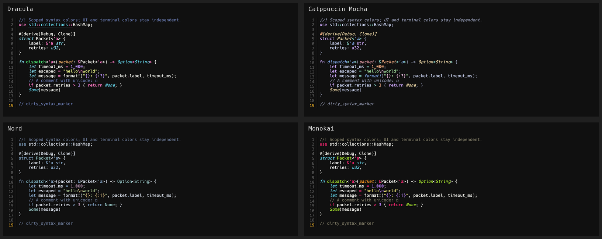

# Syntax highlighting themes

Choose **View → Syntax highlighting**, or open **Ctrl+Shift+P** and search for **Syntax theme:**. The bottom-right **Theme: …** menu also has a **Syntax highlighting** submenu; its tooltip shows the current syntax choice.

Syntax themes control source-code colors and styles independently of the [interface/terminal palette](themes.md). For example, combine Carbon's near-black interface with Dracula's code colors. Switching the interface theme keeps the chosen syntax theme. Editor backgrounds, selections, the cursor, UI controls, and terminal colors continue to use the interface palette.

| Syntax theme | ID | Appearance |
| --- | --- | --- |
| Follow UI theme | `ui` | Existing matching syntax colors; the default for older and new configurations |
| Dracula | `dracula` | Pink keywords, purple constants, green functions, yellow strings |
| Catppuccin Mocha | `catppuccin-mocha` | Soft multicolor pastel tokens |
| Nord | `nord` | Restrained cool blue, cyan, and green |
| Monokai | `monokai` | Bright pink, lime, orange, and cyan |
| One Half Dark | `one-half-dark` | Balanced blue, purple, red, and green |



These presets retain their full parser scope rules instead of reducing every language to a small set of token categories. This permits language-specific distinctions such as parameters, decorators, escapes, tags, attributes, and interpolation where the grammar and selected theme define them. Italics and underlines are rendered separately. Styling uses the existing monospace font; token backgrounds do not replace the interface background.

Selections apply immediately to open text tabs and are saved without exiting. The independent `syntax_theme` key is stored alongside `color_theme` in `${XDG_DATA_HOME:-~/.local/share}/rode/app.ron`. Multiple windows merge the two preferences independently. There is no theme watcher, download, indexing, or background service.

```sh
./target/release/rode . --theme carbon --syntax-theme dracula
./target/release/rode . --theme neon --syntax-theme catppuccin-mocha
```

`--syntax-theme` overrides the saved syntax choice for startup. Choose **Follow UI theme** to return to each interface palette's matching colors, including the existing custom UI theme's `syntax` overrides.

## Custom syntax themes

Place UTF-8 JSON files in `${XDG_CONFIG_HOME:-~/.config}/rode/syntax-themes/` and restart RODE. This directory is separate from the existing `themes/` directory for interface/terminal palettes.

For example, `detailed.json`:

```json
{
  "name": "Detailed Dracula",
  "base": "dracula",
  "foreground": "#e0e0e0",
  "rules": [
    {
      "scope": "source.rust comment.line.double-slash.rust",
      "foreground": "#9988aa",
      "font_style": "italic"
    },
    {
      "scope": "source.rust entity.name.function",
      "foreground": "#88ffcc",
      "font_style": "underline"
    },
    {
      "scope": "source.python entity.name.function",
      "foreground": "#ff88cc",
      "font_style": "normal"
    },
    {
      "scope": "constant.character.escape, punctuation.section.interpolation",
      "foreground": "#ffcc66"
    }
  ]
}
```

Select **Syntax theme: Detailed Dracula** in the palette, or use `--syntax-theme custom:detailed`. Custom IDs derive from filenames, independently of their display names and any interface theme with the same filename.

- `name`: required, 1–64 printable characters.
- `base`: an independent built-in ID from the table, except `ui`; defaults to `dracula`. Custom themes do not inherit other custom files.
- `foreground`: optional default source-text color, as opaque `#RRGGBB`.
- `rules`: up to 256 scope rules. Each needs a `scope` and at least one of `foreground` or `font_style`.
- `scope`: a syntect/TextMate-style selector, up to 512 bytes. Commas express alternatives, spaces match parent scopes, and ` - ` excludes scopes. Use sufficiently specific selectors to override more-specific inherited rules; later equally-specific rules win. Scope names depend on the language grammar.
- `font_style`: `normal`, `italic`, `underline`, or `italic underline`. Omitting it retains inherited styles; specifying it replaces the style flags for matching tokens.

Files are limited to 128 KiB each, 32 custom syntax themes, and a startup scan of at most 1,025 directory entries. Malformed/oversized definitions are reported and skipped while built-ins remain available. An unavailable stored selection falls back to **Follow UI theme**, with a visible warning.

Presets come from the embedded [two-face/bat theme collection](https://docs.rs/two-face/latest/two_face/theme/). `rode --theme-licenses` prints their bundled acknowledgements. Syntax colors use parser scopes; they do not add semantic analysis or language servers.
