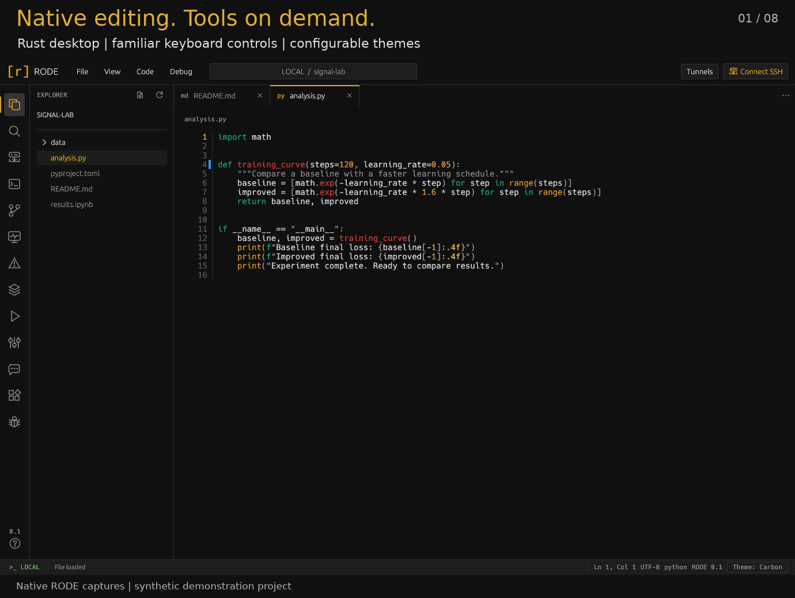

# Themes


Click **Theme: …** at the bottom right, or choose **View → Color theme**. Thirteen built-in dark themes cover the interface and terminal, with matching syntax colors when **Follow UI theme** is selected:

| Theme | CLI ID | Appearance |
| --- | --- | --- |
| Phosphor | `phosphor` | Original charcoal and soft green; the default |
| Carbon | `carbon` | Near-black, neutral panels, amber accents, teal keywords; inspired by the reference screenshot |
| Carbon Edge | `carbon-edge` | Carbon’s interface, syntax and terminal colours with amber cut-corner frames and static glow |
| Code Dark | `code-dark` | Neutral charcoal, light gray text and blue accents; inspired by VS Code's classic dark theme |
| Matrix | `matrix` | Deep green-black, bright green controls, mint functions and pale green types |
| Amber | `amber` | Retro amber terminal, warm black surfaces, gold syntax, sage strings |
| Ice | `ice` | Midnight navy, cyan controls, blue types and mint functions |
| Neon | `neon` | Dark plum, magenta controls and keywords, cyan types, violet functions |
| Afterglow | `afterglow` | Charcoal-violet panels, magenta cut-corner frames and static glow, cyan selections, cream headings and rose labels |
| Knight Rider | `knight-rider` | Near-black cockpit panels, red cut-corner frames and static glow, silver text, amber types and warm-white functions |
| Hologram | `hologram` | Midnight navy, luminous cyan double-line frames with clipped corners and segmented rails, ice-blue text and soft gold numbers |
| Telemetry | `telemetry` | Near-black instrument panels, turquoise corner brackets and hatched edge accents, mint text and green-cyan syntax |
| Studio | `studio` | Graphite surfaces, soft white text, blue-violet accents, rounded controls and tabs, coordinated typography and spacing |

Choose **View → Syntax highlighting** for independent Dracula, Catppuccin Mocha, Nord, Monokai, or One Half Dark code colors. The command palette offers **Syntax theme: …** and the status-bar theme menu exposes both choices. See [syntax themes and detailed custom scope rules](syntax-themes.md). **Follow UI theme** preserves the matching syntax colors described above.

Built-in terminal palettes follow the interface theme: default text and ANSI **White** use the theme’s text colour, with a lighter matching **Bright white**. Carbon and Carbon Edge use warm-neutral prompt accents, Amber cream and gold, Phosphor/Matrix green, Ice/Code Dark/Afterglow/Knight Rider/Hologram/Studio cool blue, Neon violet, and Telemetry turquoise. Bright prompt colours remain readable against the terminal background, while red/green status colours stay distinct. Custom themes and explicitly saved terminal colour overrides still take precedence. Use **Reset to theme defaults** to remove older custom swatches.

Bash prompt colors come from `PS1` in the shell's own configuration. RODE honors bold ANSI foreground colors using the theme's bright variants: `\e[1;30m` uses bright black and `\e[1;34m` uses bright blue. Existing prompts therefore follow the selected terminal palette without editing `.bashrc`; see [prompt rendering](terminals.md#bash-prompts-and-colors).

Choose **View → Terminal colors…**, or **Terminal: Colors and contrast** in the command palette, to adjust the terminal foreground, background and 16 ANSI colors. Settings are saved immediately, separately for each interface theme. **Reset to theme defaults** removes that theme's overrides.

**Minimum text contrast** is optional and defaults to **1:1** (off), preserving shell colors. Increase it, for example to **4.5:1**, if you want additional readability protection for terminal text, including 256-color and explicit RGB text. Correction changes only rendered text, against each cell's actual background; backgrounds, Powerline separators and box/block graphics keep their colors. A requested ratio may be impossible against a midtone background; RODE then uses the most readable black/white foreground. These settings apply to all terminal text, including local, SSH, debugger and retained error views, without changing shell configuration or restarting commands. Custom themes can set their own contrast default in the [theme format](../themes/README.md).

Navigation, command menus, and toolbar controls share a theme-aware outline icon style. Icon-only controls show descriptive tooltips; menus retain text labels and aligned keyboard shortcuts. Icons are drawn directly in Rust without an icon font or additional runtime dependencies.

The command palette (**Ctrl+Shift+P**) offers **Theme: Matrix**, **Theme: Amber**, and the other built-in/custom choices. Changes apply immediately without restarting the session. An independently selected syntax theme keeps its code colors. UI selections are flushed to local preferences as soon as they change and restored on startup; closing the application is not required to save them. On Linux the preference file is `${XDG_DATA_HOME:-~/.local/share}/rode/app.ron`.

```sh
./target/release/rode . --theme carbon
./target/release/rode . --theme carbon-edge
./target/release/rode . --theme code-dark
./target/release/rode . --theme afterglow
./target/release/rode . --theme knight-rider
./target/release/rode . --theme hologram
./target/release/rode . --theme telemetry
./target/release/rode . --theme studio
```

Studio is designed for everyday work: graphite surface layers, quiet borders, proportional interface labels and a restrained blue-violet accent. Shared component settings coordinate control heights, corner radii, card padding and heading sizes. Control outlines use a dedicated color, separate from quiet panel dividers. Keyboard focus uses a stronger outline on inputs, chat composers and buttons, including filled primary actions. Secondary text stays readable on hover, pressed and open surfaces; disabled controls are subdued, and soft shadows distinguish menus and dialogs. Code and terminal fonts keep their separate size preference. Select **Follow UI theme** for its matching syntax palette. Studio is an optional preset; Phosphor remains the default.

Hologram is inspired by a cyan holographic loading panel over navy code. Double outlines, short illuminated corners and segmented frame rails give panels a glass-like edge. Its code and terminal text stay sharp, and the glow is static. Select **Follow UI theme** for its matching cyan, mint and soft gold syntax colors.

Telemetry takes its cues from turquoise sci-fi instrument screens: open corner brackets, subdued vertical rails and small hatched edge accents on near-black panels. Matching mint text and green-cyan syntax keep the appearance cohesive. All frame details are static and stay within the panel margins.

Custom themes are JSON files in `${XDG_CONFIG_HOME:-~/.config}/rode/themes/`, loaded at startup. They can inherit any built-in palette and override UI, syntax, ANSI terminal colors and the optional native frame treatment. Carbon Edge, Afterglow, Knight Rider, Hologram and Telemetry use static decoration: code and terminal backgrounds stay solid, and switching themes preserves buffers, independent syntax choices and running shells. See the [theme format and examples](../themes/README.md). An invalid or missing theme produces a visible warning and falls back to Phosphor if the selected theme is unavailable. Presets are embedded in the binary, with no extra downloads, dependencies, or background effects.

**View → Interface scale** offers percentage presets and 5% Smaller/Larger actions for the whole interface, separately from **Editor font size**. Try 75% or 50% if the GUI looks too large on another display; [interface sizing](editing.md) explains monitor scaling, reset and keyboard access.

Multiple windows merge independent settings changes without reverting each other's preferences on exit. See [configuration and multiple windows](configuration.md) for paths, save behavior, and reload rules.


