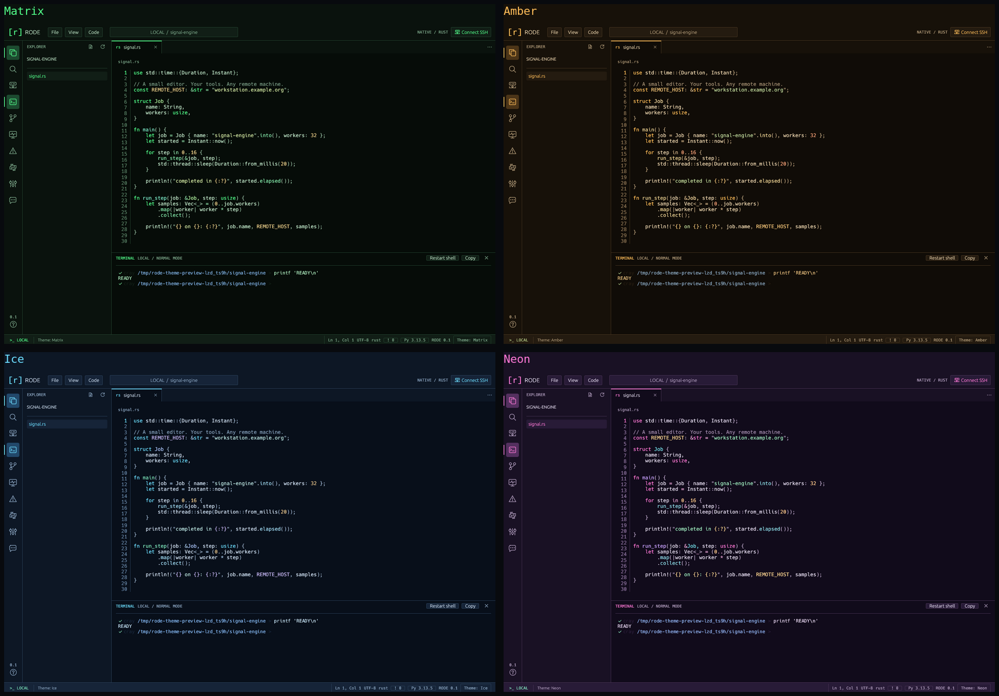

# Themes


Click **Theme: …** at the bottom right, or choose **View → Color theme**. Seven built-in dark palettes cover the interface and terminal, with matching syntax colors when **Follow UI theme** is selected:

| Theme | CLI ID | Appearance |
| --- | --- | --- |
| Phosphor | `phosphor` | Original charcoal and soft green; the default |
| Carbon | `carbon` | Near-black, neutral panels, amber accents, teal keywords; inspired by the reference screenshot |
| Code Dark | `code-dark` | Neutral charcoal, light gray text and blue accents; inspired by VS Code's classic dark theme |
| Matrix | `matrix` | Deep green-black, bright green controls, mint functions and pale green types |
| Amber | `amber` | Retro amber terminal, warm black surfaces, gold syntax, sage strings |
| Ice | `ice` | Midnight navy, cyan controls, blue types and mint functions |
| Neon | `neon` | Dark plum, magenta controls and keywords, cyan types, violet functions |



Choose **View → Syntax highlighting** for independent Dracula, Catppuccin Mocha, Nord, Monokai, or One Half Dark code colors. The command palette offers **Syntax theme: …** and the status-bar theme menu exposes both choices. See [syntax themes and detailed custom scope rules](syntax-themes.md). **Follow UI theme** preserves the matching syntax colors described above.

Navigation, command menus, and toolbar controls share a theme-aware outline icon style. Icon-only controls show descriptive tooltips; menus retain text labels and aligned keyboard shortcuts. Icons are drawn directly in Rust without an icon font or additional runtime dependencies.

[Menu icon preview](../assets/menu-icons.png).

The command palette (**Ctrl+Shift+P**) offers **Theme: Matrix**, **Theme: Amber**, and the other built-in/custom choices. Changes apply immediately without restarting the session. An independently selected syntax theme keeps its code colors. UI selections are flushed to local preferences as soon as they change and restored on startup; closing the application is not required to save them. On Linux the preference file is `${XDG_DATA_HOME:-~/.local/share}/rode/app.ron`.

```sh
./target/release/rode . --theme carbon
./target/release/rode . --theme code-dark
./target/release/rode . --theme matrix
```

Custom themes are JSON files in `${XDG_CONFIG_HOME:-~/.config}/rode/themes/`, loaded at startup. They can inherit any built-in palette and override UI, syntax, and ANSI terminal colors. See the [theme format and examples](../themes/README.md). An invalid or missing theme produces a visible warning and falls back to Phosphor if the selected theme is unavailable. Presets are embedded in the binary, with no extra downloads, dependencies, or background effects.

Multiple windows merge independent settings changes without reverting each other's preferences on exit. See [configuration and multiple windows](configuration.md) for paths, save behavior, and reload rules.


